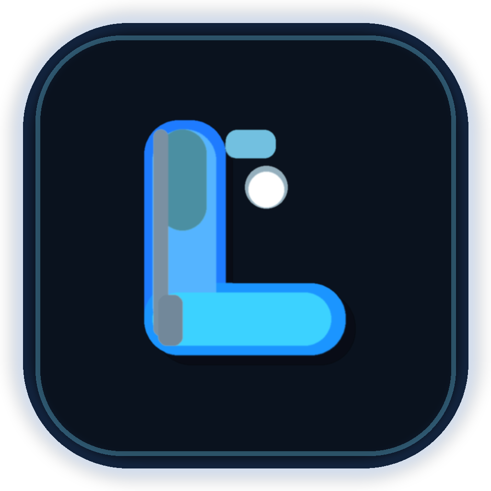

<p align="center">
  
</p>

# LocalLLM — Offline LLM Chat (Expo + llama.rn)

[](https://github.com/kumarAvinash108/LocalLLm/actions/workflows/android-apk.yml)

Chat with open-weight LLMs **fully on-device**. Download a `.gguf` model from
Hugging Face once, then chat offline — no server, no API key, no data leaves
your phone.

## 📲 Install on Android (easiest)

Download the latest APK from
[**Releases → `latest`**](https://github.com/kumarAvinash108/LocalLLm/releases/tag/latest),
install it on a physical device, then open **Models → Download → Load in Chat**.
Every push to `main` triggers a fresh build, so the APK is always up to date.
Expo Go is **not** supported (the app needs native llama.cpp code).

- **Engine:** [`llama.rn`](https://github.com/mybigday/llama.rn) (llama.cpp binding, MIT)
- **App:** Expo SDK 57 + React Native New Architecture
- **Storage:** `expo-file-system` for `.gguf` weights, `expo-sqlite` kv-store for chats/settings, `expo-document-picker` for importing `.gguf` files already on device
- **License:** MIT — see [`LICENSE`](./LICENSE); third-party notices in
  [`THIRD-PARTY-NOTICES.md`](./THIRD-PARTY-NOTICES.md)

## How it works

```
Hugging Face / URL / device (one-time)   On-device (offline forever after)
─────────────────────────────────       ────────────────────────────────
Models screen → pick a GGUF       ──►   expo-file-system stores .gguf
  (a) curated catalog                   in app documents (/localllm-models)
  (b) custom repo + file                - direct-URL downloads saved the
  (c) direct https:// .gguf URL           same way (id derived from filename)
  (d) import .gguf from device          - device imports copied (never
      (file manager → copy)               referenced in place)
          │
          ▼
"Load in Chat" → llama.rn initLlama() maps weights into memory
          │
          ▼
Chat screen → llama context.completion({ messages }) streams tokens
```

Key files:

| Path | Role |
|---|---|
| `src/data/models.ts` | Curated GGUF catalog (default: Qwen 2.5 0.5B Q4_K_M) |
| `src/services/huggingface.ts` | `https://huggingface.co/<repo>/resolve/main/<file>` URL builder + `.gguf` repo browser via HF Hub API |
| `src/services/modelDownloader.ts` | Resumable HF + direct-URL download with progress/cancel, device `.gguf` import (`importGgufFile`), and size-only `validateGgufFile` (uses `expo-file-system/legacy`) |
| `src/services/llm.ts` | Singleton owner of the native `LlamaContext` (load/unload/streaming completion/stop) |
| `src/services/mirage.ts` | Cactus Compute Mirage on-device VLM (~22 MB): single-pass OCR + scene captioning + object detection |
| `src/services/ocr.ts` | On-device OCR (Mirage / ML Kit) — image pixels → prompt text |
| `src/services/imageRecognition.ts` | On-device image recognition — photo → object/scene labels |
| `src/services/chatImages.ts` | Image picking/persisting + parallel OCR + labeling per attachment |
| `src/services/chatExport.ts` | Chat export & sharing (Markdown, plain text, JSON backup, and JSON file import) |
| `src/context/ModelContext.tsx` | Download/load/import state for the UI (progress, errors, persistence; exposes `download`, `downloadFromUrl`, `importFromDevice`) |
| `src/context/ChatContext.tsx` | Chat history + streaming inference (calls `llm.chatCompletion`) + chat backup import |
| `src/screens/ModelScreen.tsx` | Download → Load → Chat UI: curated catalog, custom repo/file + `.gguf` browser, **import `.gguf` from device**, **download from direct URL** |
| `src/components/ExportModal.tsx` | Export dialog: Share formatted text, export `.md`/`.txt`/`.json`, and backup all chats |
| `src/components/ModelBanner.tsx` | "No model loaded" banner in chat |

## Prerequisites

- Node 20+, npm
- **Custom dev build is required** — llama.rn ships native code, so
  **Expo Go is NOT supported**:
  ```sh
  npm install
  npx expo prebuild        # generates android/ ios/
  npx expo run:android     # or run:ios
  ```
- For iteration after the first native build: `npx expo start --dev-client`
- Physical device recommended (emulators work but are slow; models need
  1–3 GB free RAM depending on size).

## Quick start

```sh
npm install
npx expo prebuild
npx expo run:android   # or: npx expo run:ios
```

Then in the app:

1. Tap the **chip icon** in the header (or menu → **Models**).
2. Tap **Download** on *Qwen 2.5 0.5B Instruct (Q4_K_M)* (~ mid-hundreds MB).
3. Tap **Load in Chat** — wait for "Loaded in chat".
4. Go back and start chatting. Fully offline from here on.

### Custom Hugging Face model

In **Models → Custom Hugging Face model**:

- Enter `owner/name` (e.g. `bartowski/Qwen2.5-1.5B-Instruct-GGUF`),
- Tap **Browse .gguf files** to list candidates (prefers `Q4_K_M`),
  or type the filename directly (must end in `.gguf`),
- Tap **Download**, then **Load in Chat**.

Rules: public repos only; URL pattern is
`https://huggingface.co/<repo>/resolve/main/<file>`. Gated repos
(e.g. original `meta-llama/*`) require license acceptance in a browser —
use `bartowski/*-GGUF` mirrors instead.

### Import a .gguf already on device

In **Models → Import .gguf from device**:

1. Tap **Pick .gguf file** and choose the file with the system file manager
   (e.g. from Downloads or another app).
2. The file is **copied** into the app's private model library
   (`/localllm-models`, id derived from the filename) and validated by size —
   files under ~10 MB are rejected as incomplete.
3. Tap **Load in Chat**.

Only files ending in `.gguf` are accepted. The original file is left untouched.

### Download from a direct URL

In **Models → Download from direct URL**:

- Paste a direct `https://` link to a `.gguf` file (it must end in `.gguf`),
  e.g. a GitHub release asset
  (`https://github.com/<owner>/<repo>/releases/download/.../model.gguf`),
- Optionally set a display name, then tap **Download URL** → **Load in Chat**.

Paste the raw download URL, not an HTML/repo page URL. Imported and
URL-downloaded models keep their own licenses — check the source before use.

### Ask about images (offline vision & Mirage OCR)

Tap the **image icon** in the chat input to attach up to 3 photos (library
or camera). Each image is analyzed fully on-device utilizing
[**Cactus Compute Mirage**](https://cactuscompute.com/blog/mirage)
(`Cactus-Compute/mirage`), an ultra-compact ~22 MB Vision-Language Model:

- **OCR (Optical Character Recognition):** Reads text, documents, signs, numbers,
  and receipts from the image in a single fast forward pass.
- **Scene Description:** Generates a concise natural-language caption describing
  the environment and context of the image.
- **Object Detection:** Identifies items, people, and scenes with confidence tags.

All visual understanding results are injected into the prompt as text so the
on-device GGUF model can answer questions like "what's in this photo?" or
"summarize the receipt" 100% offline.

### App size optimizations

The Android build is optimized for compact device footprints:
- **Architecture targeting (`arm64-v8a`):** Targets 64-bit ARM devices (99%+ of modern
  physical Android phones) via `expo-build-properties` instead of bundling 4 separate
  ABIs into a monolithic universal APK, shrinking the package by ~75%.
- **ProGuard / R8 code & resource shrinking:** Strips unused classes and unused resources.
- **Removed Hexagon DSP overhead:** Disabled Qualcomm Hexagon binaries in `llama.rn`
  to save native library bloat.

### Export & share chats

Tap the **share icon** in the top bar (or tap share on any past chat in the
sidebar drawer):

- **Share Formatted Text:** Instantly opens the native share sheet with
  clean Markdown to send via messaging apps, email, or copy to clipboard.
- **Export Markdown (`.md`):** Generates a formatted `.md` file with timestamps,
  model details, and image descriptions.
- **Export Plain Text (`.txt`):** Generates a universal `.txt` transcript.
- **Export JSON Backup (`.json`):** Full structured chat backup that can be
  re-imported anytime.
- **Backup All Chats:** One-tap export of your entire conversation history to
  a single `.json` file.
- **Import Chats:** Tap the import button in the drawer header to restore
  previous chats from `.json` backups.
- **Individual Message Share:** Tap the subtle share icon on any message to
  quickly share or copy just that answer.

## Configuration

- **Context size:** `n_ctx: 2048` default in `src/services/llm.ts` (`loadModel` call in `ModelContext`). Raise for longer memory at the cost of RAM/speed.
- **Temperature / max tokens:** `Settings` screen persists `temperature` / `maxTokens`; `ChatContext` passes them to every completion (`n_predict`).
- **Catalog:** edit `src/data/models.ts` to add/remove curated entries.

## Model licenses (important)

This repo's MIT license covers **the app code only**. Downloaded weights
keep their own licenses (Apache-2.0, Llama Community License, etc. —
noted per entry in `src/data/models.ts`). Review the license on the
model's Hugging Face page before downloading.

## Troubleshooting

| Symptom | Fix |
|---|---|
| "No model is loaded yet" in chat | Open Models → Download → **Load in Chat** |
| Download HTTP 404 | Wrong repo/file spelling; use **Browse .gguf files**. For direct URLs, make sure you pasted the raw `.../releases/download/.../*.gguf` link, not an HTML page |
| 401/403 on lookup | Gated/private repo — use a public `*-GGUF` mirror |
| "Not a .gguf file" / URL must end in `.gguf` | The picker/URL only accepts files ending in `.gguf` — re-check the filename or link |
| "Model file looks incomplete" after import | Source file was truncated (< ~10 MB) — re-download it on a stable connection and import again |
| Load fails / app killed | Model too big for device RAM — try the 0.5B or 360M model |
| "Missing JSI bindings" / native crash | Rebuild the dev client (`npx expo prebuild && run:`); Expo Go won't work |
| Slow tokens | Expected on CPU; smaller quants (`Q4_K_M`) and shorter `maxTokens` help |

## Scripts

| Command | Purpose |
|---|---|
| `npm start` | Start Metro (dev-client only; needs native build) |
| `npm run android` / `npm run ios` | Start + open platform |
| `npx tsc --noEmit` | Typecheck |

## License

MIT © 2026 LocalLLM Contributors — see [`LICENSE`](./LICENSE).
Dependency licenses: [`THIRD-PARTY-NOTICES.md`](./THIRD-PARTY-NOTICES.md).

## Contributing

PRs welcome — please read [`CONTRIBUTING.md`](./CONTRIBUTING.md) first
(dev build required, quality gates, and how releases work).
